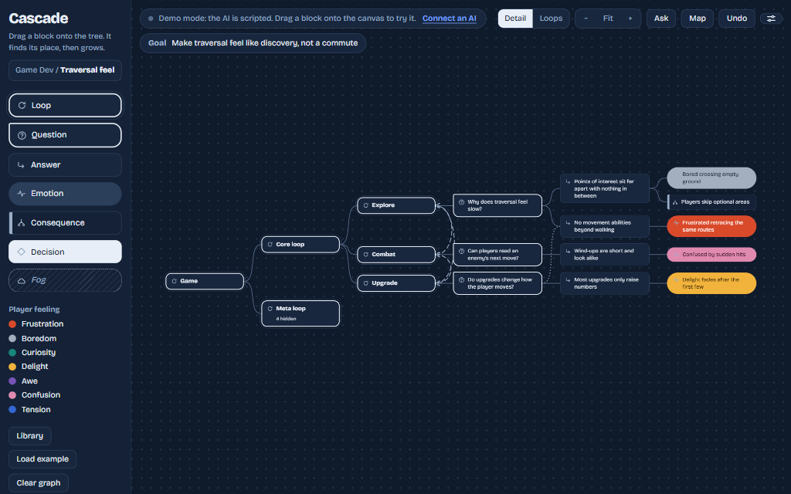
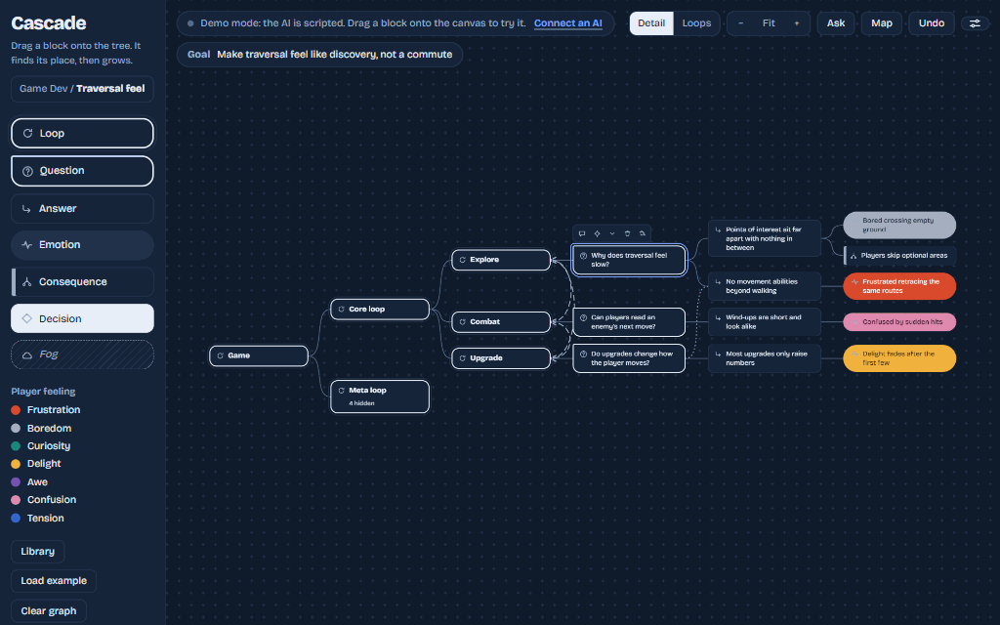
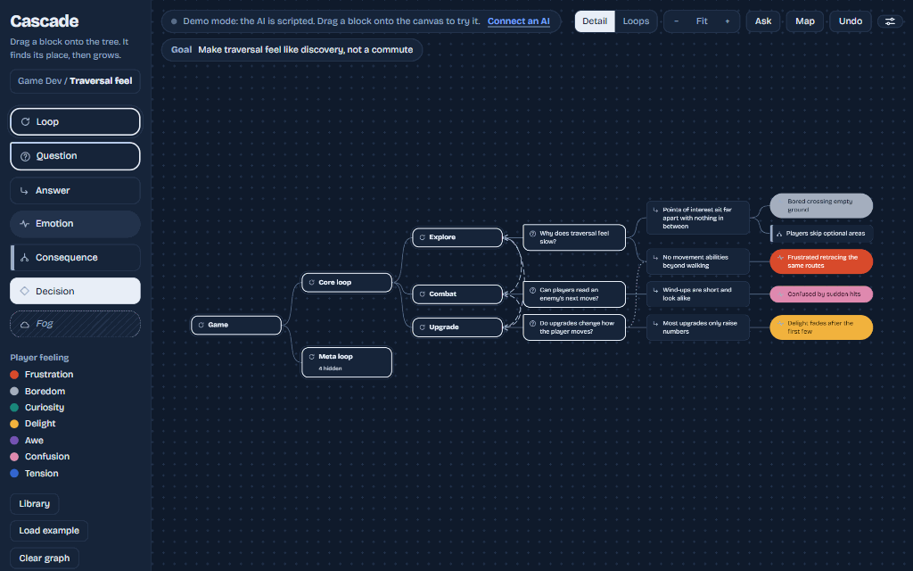
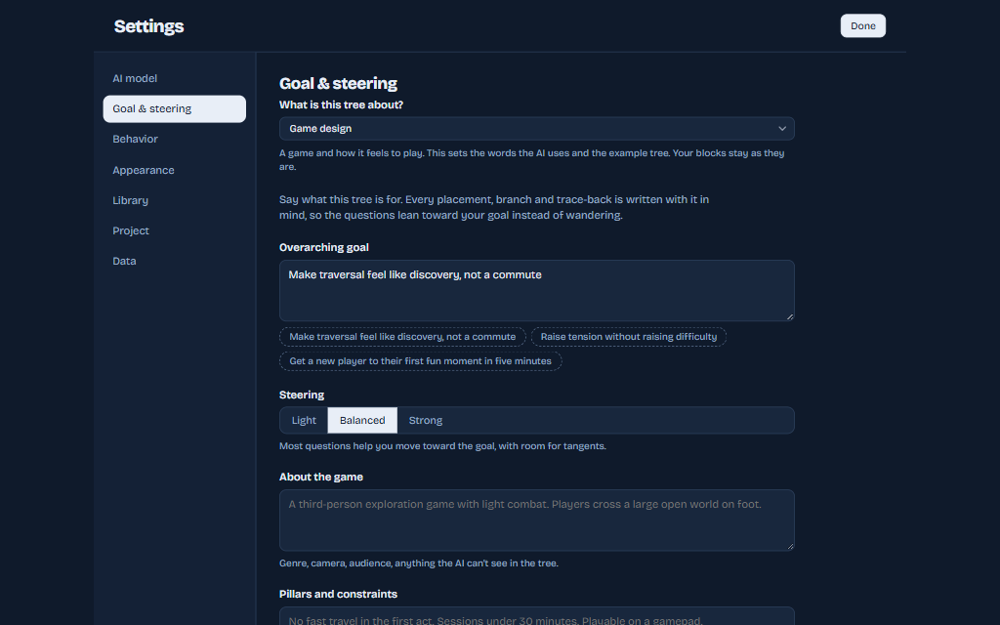
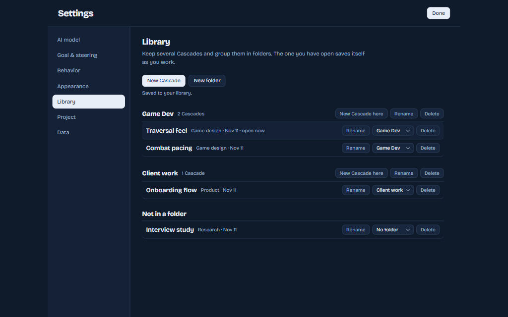

# Cascade

> **A branching tool to help you find and ask better questions to get better answers. For game design, product work, research, or any decision.**

You ever had those moments where you had a question and realized that you had 2 prominent answers and they both contradict each other? Well this tool helps you expand on both those answers as well as opening up more questions because of those answers to settle the debate.

You give the application some background knowledge of your project, then drop in a question. Its more effective if they are yes and no type of questions. The A/B style. The AI, or whatever AI endpoint you decide to use, will often fork out 3 prominent branches:

- The A
- The B
- The Hybrid of both

And it'll try do that for every question you have. It essentially lets you get an overview of as many possible and potential branches to help you get as deep as you want to go with your initial question.

The fun part is you can ask questions separately and if it's related to an existing branch of questions, it can slot itself there and branch off.

The ultimate goal of the branching is to try and reach an emotion that lines up with what you want your players to feel and once you are happy with a particular line of branching, you can solidify all the branches you want and clear the rest of the ghost suggestions, leaving you with your finalized small linear graph on why you made that decision and why it was done that way.

I made this because I often found myself, and the teams I work in, having lots of questions and opinions on how things should be. Often we go around in circles and never really reach a point. Both sides make great points and both have their merits. This tool helps in a more granular level and perhaps find holes in our ideas before we spend resources on prototyping.

"To help you find better questions in order to reach better answers"

This is not an answering tool. It's a questioning tool. The AI doesn't agree with you, it just uses its power to ask more questions and poke you about your decisions.

Hope you find this useful!

## See it work

Everything below was recorded in the app itself with the built-in demo AI, so you can try the same steps without a key.
Connect a real model in Settings and the questions become specific to your own tree.

### Branching

Place a block and Cascade finds where it belongs. Ask it to grow from any node and it suggests answers, consequences and
follow-up questions as ghosts. Keep the ones that ring true, dismiss the rest.

### Ask the graph

Ask a question in plain words. If a chain of blocks answers it, that thread lights up on the canvas in order. If nothing does,
you see what is missing.

### Grill me

Pick a question and let Cascade interview you about it. It asks, you decide. Thin answers get pushed back on, and a settled
answer lands on the canvas as a decision.

### Bridge to a feeling

Already have questions in the tree, and know the feeling you want people to end up with but not the steps in between? Drag out
an **Emotion** block and describe it. Cascade works from both ends at once: it asks the next questions that would lead from
your existing nodes toward the feeling, and traces the feeling back to actions that could cause it. Where the two chains meet,
they are linked.

If the ends cannot meet, Cascade says so and starts a grill focused on the missing step, so your answers close the gap.

### Domains and the library

Choose what the tree is about, and keep several Cascades in folders. The open one is named in the top-left corner and saves
as you work.

  
  

To refresh these, run `npm i --no-save puppeteer-core gifenc pngjs` and then `node scripts/capture-media.js`.

## Who it is for

Pick what your tree is about in **Settings > Goal & steering**: General, Product, Research or Game design. The choice sets the
words the AI uses, the examples, the starter tree and how a project folder is read. The AI still asks specific, probing
questions, using the vocabulary of that domain. Profiles live in `app/js/core/profiles.js`, so adding one is a single entry.

## Library

The **Library** tab keeps several Cascades, grouped in folders. The open Cascade saves itself as you work. The local app stores
them on your computer; the Cloudflare version stores them in your account (see [worker/README.md](worker/README.md)).

## Tech stack

- **Runtime:** Node.js 18+ with no runtime dependencies (built-in modules only).
- **Frontend:** vanilla HTML, CSS and JavaScript, no framework and no build step for the local app. `app/app.html` is the shell;
  styles are in `app/css/` and scripts in `app/js/` (`core`, `canvas`, `ui`, `ai`, `features`), loaded in the order listed in
  `app/manifest.json`. `scripts/assemble.js` inlines them for the web build and the tests.
- **Server:** `server/server.js` starts `lifecycle.js` (ports, shutdown) and `app.js` (guards and dispatch); `routes/*.js` hold the
  endpoints and `lib/*` the providers, settings and project scanner. Library rules are shared in `shared/library.js`.
- **Cloud (optional):** Cloudflare Workers + D1 with Google sign-in, in `worker/`.
- **AI providers:** OpenRouter, ChatGPT plan (local app), Anthropic API, OpenAI API, or any OpenAI-compatible endpoint
  (Ollama, LM Studio, Groq).
- **Testing:** Node's built-in test runner with jsdom, local mock providers, and SQLite standing in for D1. `npm test`.
- **CI and hosting:** GitHub Actions, with the static web build deployed to GitHub Pages.
