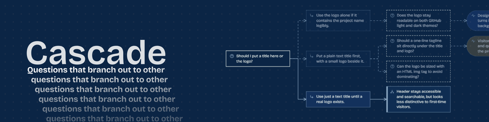

Find better questions to reach better decisions. Cascade connects questions, answers, consequences, and emotions in a visual tree for game design, product work, research, or everyday planning.

[✨ Open Cascade](https://cascade.unscriptedlogic.com/) · [🎮 Static demo](https://unscriptedlogic.github.io/Node-Tool-Cascade/) · [📖 User guide](docs/guide.md)

## 🌿 Features

- Explore suggested branches and keep the ideas that matter.
- Ask questions about your tree and highlight related decisions.
- Challenge assumptions with an interview, or bridge decisions to a desired feeling.
- Organize multiple trees in folders and choose a domain for each.
- Customize your canvas, use mobile layouts, and connect local project notes and code.

## 🚀 Run locally

Requires [Node.js](https://nodejs.org/) 18 or newer. No dependency installation needed to run the app.

```bash
git clone https://github.com/UnscriptedLogic/Node-Tool-Cascade.git
cd Node-Tool-Cascade
npm start
```

Your browser opens at `http://localhost:4173`, or the next available port. You can also launch with `start.bat` on Windows or `start.command` on macOS.

Start in demo mode without an account. Connect a provider in **Settings** for model-powered features. The local app supports OpenRouter, ChatGPT, Anthropic, OpenAI, and compatible local endpoints.

Project excerpts used for these features go to your selected provider. Use a local model to keep them on your computer. The hosted app collects anonymous usage counts; disable them in **Settings > Data**.

## 🛠️ Development

Built with vanilla HTML, CSS, JavaScript, and Node.js. No runtime dependencies for the local app.

```bash
npm install
npm test
npm run build
```

The build creates `dist/web/index.html` for static hosting. Optional cloud hosting, account storage, and deployment instructions are in the [cloud guide](worker/README.md).

## 📄 License

[MIT](LICENSE)
